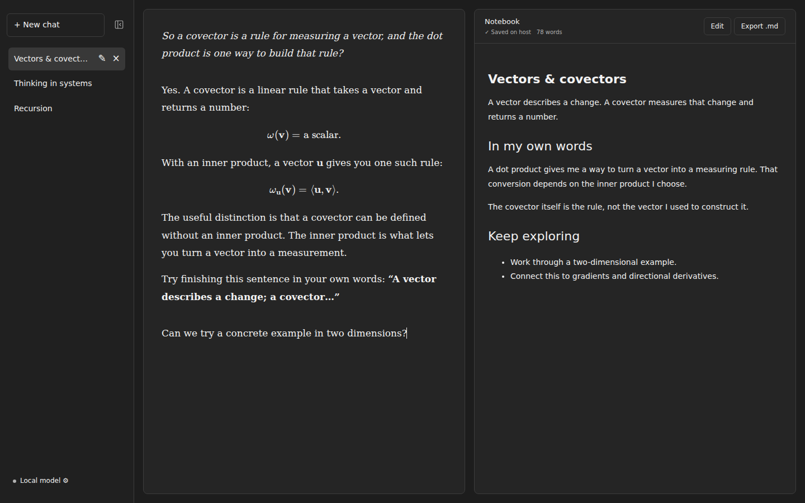

# Verso

When everything can be saved, nothing demands your attention.

Verso is built on the idea that constraints can foster focus. When everything produced by an LLM can be saved and revisited later, it's far too easy to accumulate a library's worth of markdown files without ever engaging with their contents. You become a passive observer of the LLM's thought process rather than an active participant. In Verso, every LLM response disappears after a single turn, while your own notes persist. The LLM helps you explore, question, and refine your understanding, but you decide what's worth keeping.



## Get started

You’ll need Python 3.13+, [uv](https://docs.astral.sh/uv/), Node.js 22.12+ (or 24+), and a running local model server such as Ollama with a model already installed.

From a checkout of this repository:

```bash
uv sync --locked
npm ci
npm run build
uv run main.py
```

Open **http://127.0.0.1:8000**. Choose **Local model** at the bottom of the sidebar, enter your installed model’s name, and select **Save & test connection**.

The defaults are `gemma4:12b` and `http://127.0.0.1:11434/v1`. Verso does not download models. Match **Context window** to your model server’s configuration; leave **Maximum response tokens** blank to use the model’s own limits.

## Usage

- **Start a topic.** Use **New chat**; each topic has its own conversation and notebook.
- **Write on the page.** Click blank space in the chat to begin. **Enter** sends; **Shift+Enter** adds a line. Continue beneath the reply. Click the small pulsing dot to stop a response.
- **Keep what matters.** Write your notes in the notebook. **Preview**, beside the contextual actions, renders Markdown, tables, and math; **Edit** returns to the source. A small footer shows save status, word count, and whether actions apply to a selected passage or the whole notebook.
- **Arrange your space.** Use the expand icon beside **Text / Ink** for notes-only, then the split icon to bring the conversation back. Split view stacks the panels in portrait and places them side by side in landscape. Drag the small handle between them to adjust their sizes; each orientation remembers its divider position. Phones also have a **Split** shortcut beside Chat and Notebook.
- **Write by hand.** Switch the notebook to **Ink** for a continuous canvas. Write with your pen, pan with two fingers, and pinch to zoom. **Move** also lets you drag with one finger; **Return to writing** brings you back. Use **Select** to share an area with the assistant, or leave nothing selected to share the visible writing. Run **Save & verify images** in Model settings first. Ink drafts are saved on the tablet and synchronized to the host; text notes stay separate.
- **Turn handwriting into text.** In Ink, **Convert all** transcribes the whole notebook, including offscreen writing; with a selection, **Convert** transcribes just that area. The result is appended to Text as a marked section with LaTeX equations, then opens in Preview for review. Existing text and handwriting stay intact. Long notebooks convert in sections; Cancel stops without appending partial results.
- **Work with an idea.** Use **Explore**, **Check**, or **Test Me** in the notebook header for deeper connections, a review, or one question to answer. Highlight a passage in Edit or Preview to focus the action; with nothing selected, it uses the whole notebook. Your notes and any unfinished chat draft stay intact.

Notes and conversations are stored on the machine running the app, in `data/notebook.sqlite3` by default. Ink recovery drafts and completed conversions waiting to be appended also live in this browser’s storage. The app has no login and is intended for local or trusted private access.

For development, hosted models, backups, and private access from other devices, see the [development and hosting guide](docs/development.md). The [devlog](DEVLOG.md) records how the prototype evolved; the [PRD](prd.md) describes the original vision and future experiments.
